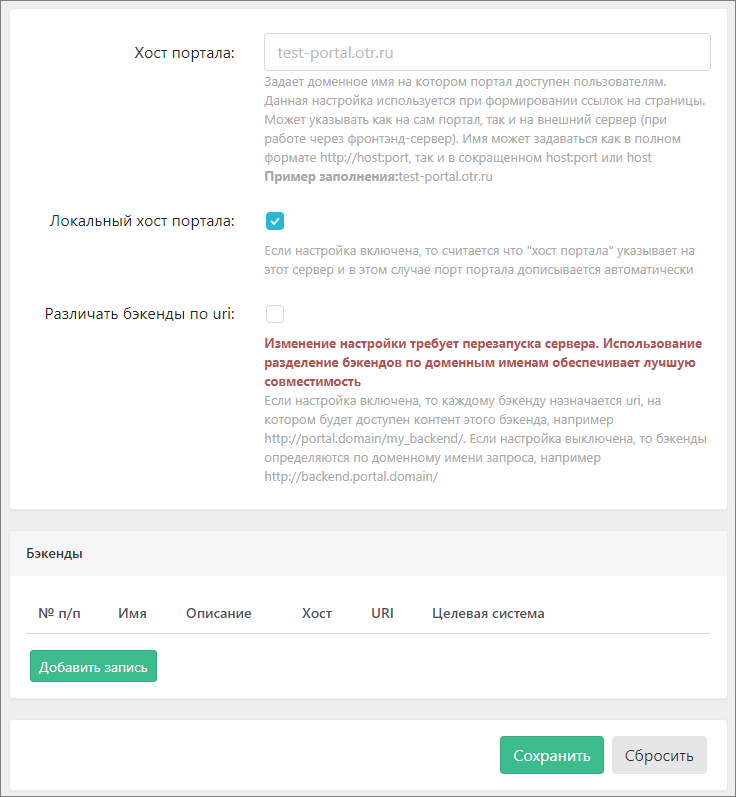
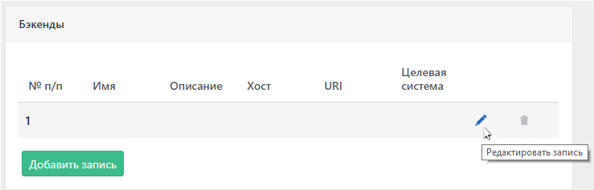
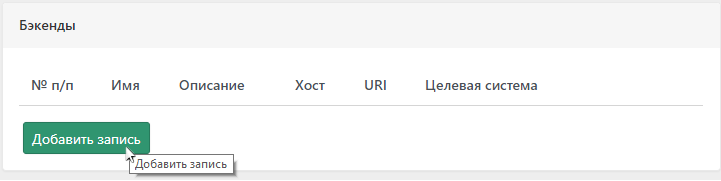
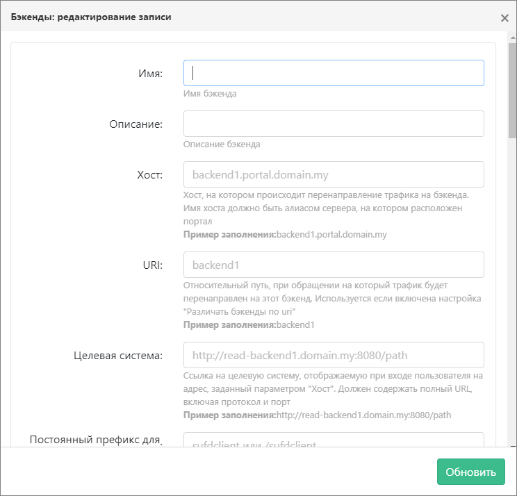
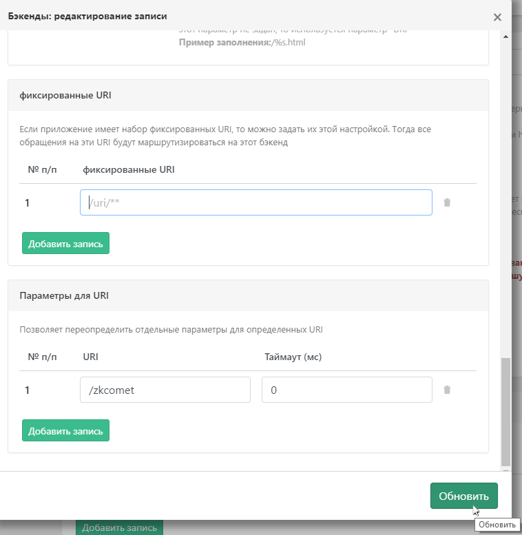
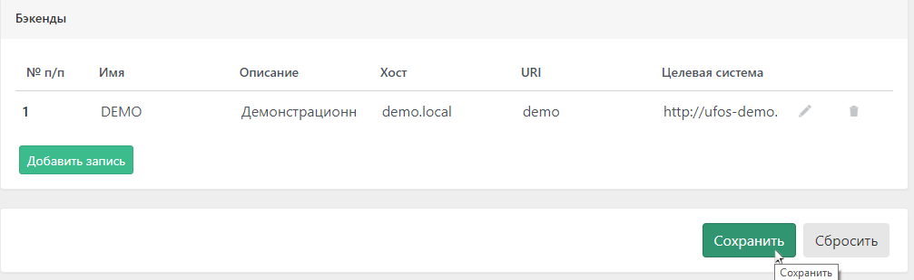
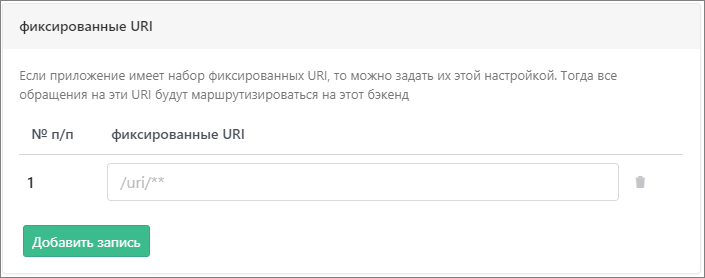
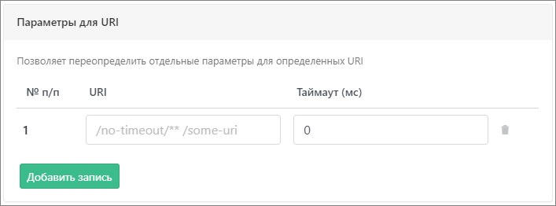

:nofooter:
:linkattrs:
= Бэкенды

Обеспечивает взаимодействие с бэкендами (другими системами), для которых Портал является входной точкой. Бэкендами могут выступать любые Web-приложения

== Настройка бэкендов

Перейти к настройке бэкенда можно путем последовательного выбора пунктов меню `Основные` и `Бэкенды`.
После выбора пункта меню `Бэкенды` будет открыта страница конфигурации вида:

На странице представлены поля для ввода значений общих настроек, а также список настроенных бэкендов с возможностью удаления, добавления и модификации их значений.

=== Общие настройки

.Общие настройки бэкендов
|===
|Наименование |Описание

|Хост Портала
|Задает доменное имя на котором Портал доступен пользователям. Данная настройка используется при формировании ссылок на страницы. Может указывать как на сам Портал, так и на внешний сервер (при работе через фронтэнд-сервер). Имя может задаваться как в полном формате `\http://host:port`, так и в сокращенном `host:port` или host
 Пример заполнения: `test-portal.otr.ru`

|Локальный хост Портала
|Если настройка включена, то считается что "хост Портала" указывает на этот сервер и в этом случае порт Портала дописывается автоматически

|Различать бэкенды по uri
|Если настройка включена, то каждому бэкенду назначается uri, на котором будет доступен контент этого бэкенда, например `\http://portal.domain/my_backend/`. Если настройка выключена, то бэкенды определяются по доменному имени запроса, например `\http://backend.portal.domain/`. Использование разделение бэкендов по доменным именам обеспечивает лучшую совместимость
|===

IMPORTANT: Изменение значения настройки `Различать бэкенды по uri` требует перезагрузки сервера.

==== HOW TO: Задать доменное имя Портала
Имеется Портал `portal.otr.ru`, для которого настроены бэкенды. Требуется обеспечить доступ пользователей к Порталу данному доменному имени. Для решения такого рода задачи необходимо

* указать значение `portal.otr.ru` для настройки `Хост Портала` либо оставить его пустым
* включить настройку `Локальный хост Портала`

==== HOW TO: Прокинуть трафик на Портал через фронтенд сервер
Имеется Портал `portal.otr.ru` для которого настроены бэкенды. Требуется обеспечить доступ пользователей по фронтенд-url `frontend.ru`. Для решения такого рода задачи необходимо

* указать значение `frontend.ru` для настройки `Хост Портала`
* выключить настройку `Локальный хост Портала`

=== Добавление нового бэкенда

Для добавления настроек нового бэкенда необходимо нажать кнопку `Добавить`

Затем выбрать добавленную строку в списке и нажать кнопку `Редактировать`.

В открывшемся диалоге редактирования настроек бэкенда необходимо внести соответствующие значения.

=== Настройки бэкенда
.Настройки бэкенда
|===
|Наименование |Описание | Комментарий

|Имя
|Имя бэкенда.
|Для бэкендов, связанных с функционалом открытия документа по ссылке (link:/p/admin/help/ufos-support/admin[см. здесь]), необходимо задать имя в точности так, как задано имя функциональной подсистемы в справочнике-ассоциаторе типов документов и фунциональных подсистем.

|Описание
|Описание бэкенда
|

|Хост
|Хост, на котором происходит перенаправление трафика на бэкенд. Имя хоста должно быть алиасом сервера, на котором расположен Портал
|Пример заполнения: `backend1.portal.domain.my`

|URI
|Относительный путь, при обращении на который трафик будет перенаправлен на этот бэкенд. Используется, если включена настройка `Различать бэкенды по uri`
|Пример заполнения: `backend1`

|Целевая система
|Ссылка на целевую систему, отображаемую при входе пользователя на адрес, заданный параметром "Хост". Должен содержать полный URL, включая протокол и порт
|Пример заполнения: `\http://read-backend1.domain.my:8080/path\`

|Постоянный префикс для страниц целевой системы
|Может быть пустым. Если префикс задан, то он будет добавлен в адрес страницы по умолчанию и в URI, по которому загружается компонент бэкенда при переходе в навигации. Допустимо, чтобы префикс начинался с символа /. Т.е. может быть задан как "sufdclient" или "/sufdclient"
|Пример заполнения: `sufdclient` или `/sufdclient`

|Страница по умолчанию
|Страница целевой системы, открываемая по умолчанию
|`/index.html`

|Страница выхода
|Страница целевой системы, вызов которой будет осуществлен во время выхода из Портала
|`/logout.html`

|Перезапись ссылок контента
|Данная опция включает замену всех ссылок, в контенте, который возвращает бэкенд, на ссылки, ведущие через Портал.
|*Данная опция может серьезно снизить скорость работы системы.*

|Таймаут (мс)
|Время в миллисекундах, в течение которого ожидается ответ сервер.
|Если ответ не приходит, клиенту возвращается ошибка с HTTP-кодом 408. Значение -1 отключает таймаут. Данная опция используется для уменьшения нагрузки на бэкенд, который перегружен запросами пользователей и не может отвечать быстро.

|Количество потоков
|Количество потоков, обслуживающих обращения к этому бэкенду.
|Вся обработка асинхронная, в связи с чем нет необходимости задавать большое значение данном параметру. Рекомендуемое значение - 10. *Изменение значения параметра требует перезагрузки сервера*

|Размер очереди
|Размер очереди, в которую помещаются входящие запросы, если все потоки заняты.
|После достижения предельного значения очереди, запросы отклоняются. Значение -1 делает очередь безразмерной.  *Изменение значения параметра требует перезагрузки сервера*

|Размер очереди (динамический)
|Задает размер очереди, который может быть изменен динамически, без необходимости перезагрузки сервера.
|Значение не может превышать значение параметра `Размер очереди`

|Health URI
|Задает URI для проверки работоспособности бэкенда (если задан), на который будет периодически отправляться HEAD запрос. Если запрос возврашает код состояния `200`, бэкенд считается работоспособным.
|Пример заполнения: `/status`

|Тип бэкенда
|Определяет тип бэкенда для загрузки навигации. Параметр может быть не задан. Параметр влияет на то, какие компоненты будут довстроены в Портал.
|На данный момент доступны два типа: `УФОС` и `Бюджетное планирование`, оба они влияют на состав компонента дерева навигации.

|URI-компонентов
|Задает URI по которому загружается компонент бэкенда при переходе в навигации. URI должен содержать пару символов %s, вместо которых будет подставлен индентификатор выбранного узла навигации. Если этот параметр не задан, то используется параметр "URI"
|Пример заполнения: `/%s.html`

|Формат ссылки на открытие документа
|Задает именованный шаблон для составления ссылки. Допустимые имена переменных:
|host - url текущего Портала; uri - наименование бекенда; backendPrefix - постоянный префикс для страниц целевой системы
|mode - действие(EDIT, например); guid - идентификатор документа; documentType - тип документа. Переменная начинается с символа '&' или '$'.
|Если необходимо добавить символы после значения переменной, то необходимо между переменной и значением поставить символ '*'
|Пример шаблона: &host/&uri/&backendPrefix*Example/&mode/GUID/&guid
|После обработки: http://localhost:8080/pur/sufdExample/edit/GUID/4a3a0d54-350e-43c0-8ad8-38e8a1f567e4
|===

=== Сохранение настроек бэкенда
Для сохранения акутальных значений настроек бэкенда необходимо нажать кнопку `Обновить` диалогового окна `Бэкенды: редактирование записи`. После чего диалог будет  закрыт, а новая (либо измененная) запись о бэкенде будет отображаена в списке бэкендов.

Для того, чтобы обновленная конфигурация была сохранена, требуется нажать кнопку `Сохранить`.

==== Фиксированные URI
Блок настроек `Фиксированные URI` предоставляет возможность задать набор фиксированных URI, обращения к которым будут маршрутизироваться на данный бэкенд.

`Фиксированные URI` задаются в виде перечня URI внизу страницы редактирования настроек бэкенда.

NOTE: Если URI бэкенда уникален в составе конфигурации Портала, то предпочтительно указать его в фиксированных URI и не включать перезапись ссылок контента.

==== Параметры URI
Блок настроек `Параметры URI` предоставляет возможность переопределить отдельные параметры для определенных URI.
В текущей версии приложения такой переопределяемый параметр только один - это таймаут (в миллисекундах) ожидания ответа от узла с заданным URI.

Параметры URI задаются в виде перечня URI и соответствующих значений таймаута. Блок настроек расположен внизу окна редактирования настроек бэкенда и имеет слеудющий вид:

NOTE: Например, может потребоваться переопределить таймаут для ресурсов ZK для бэкендов УФОС. В случае, если установлена проблема с превышением интервала ожидания ответа при загрузке ZK-ресурсов, можно добавить для URI /zkcomet таймаут 0.

NOTE: Действия по выгрузке и загрузке контента так же могут быть длительными операциями. Целесообразно для участвующих в этих операциях ресурсов кастомизировать значения таймаута в параметрах URI.

== Настройки бэкендов для различных подсистем

.Рекомендуемые настройки бэкенда для Подсистемы бюджетного планирования
|===
|Наименование настройки |Рекомендуемое значение

|Имя
|bars

|Описание
|МФ. Подсистема бюджетного планирования

|Хост
|bars.elk-dev-portal.otr.ru

|URI
|bp

|Целевая система
|\http://bfo.bars-open.ru/

|Постоянный префикс для страниц целевой системы
|

|Страница по умолчанию
|/bp_stable/login

|Страница выхода
|

|Перезапись ссылок контента
|Нет

|Таймаут (мс)
|150000

|Количество потоков
|10

|Размер очереди
|100

|Health URI
|

|Тип бэкенда
|Бюджетное планирование

|URI-компонентов
|

2+|Дополнительно

|Фиксированные URI
|/bp_stable/**

|===

.Рекомендуемые настройки бэкенда для Подсистема учета и отчетности
|===
|Наименование настройки |Рекомендуемое значение

|Имя
|arp

|Описание
|ФК. Подсистема учета и отчетности

|Хост
|portal.elk-dev-portal.otr.ru

|URI
|arp

|Целевая система
|\http://eb-arp-ext-sso.otr.ru:65321/

|Постоянный префикс для страниц целевой системы
|

|Страница по умолчанию
|arp

|Страница выхода
|

|Перезапись ссылок контента
|Да

|Таймаут (мс)
|3000

|Количество потоков
|10

|Размер очереди
|100

|Health URI
|

|Тип бэкенда
|УФОС

|URI-компонентов
|

|===

.Рекомендуемые настройки бэкенда для Подсистема управления расходами
|===
|Наименование настройки |Рекомендуемое значение

|Имя
|PUR

|Описание
|ФК. Подсистема управления расходами

|Хост
|ufos.elk-dev-portal.otr.ru

|URI
|pur

|Целевая система
|\http://eb-core-test-ufosr.otr.ru:8889

|Постоянный префикс для страниц целевой системы
|sufdclient

|Страница по умолчанию
|/briefIndex.zul

|Страница выхода
|

|Перезапись ссылок контента
|Да

|Таймаут (мс)
|9000

|Количество потоков
|10

|Размер очереди
|100

|Health URI
|/status

|Тип бэкенда
|УФОС

|URI-компонентов
|/briefIndex.zul?go=%s

|===

.Рекомендуемые настройки бэкенда для Подсистема сводной отчетности
|===
|Наименование настройки |Рекомендуемое значение

|Имя
|ufoss

|Описание
|ФК. Подсистема сводной отчетности

|Хост
|

|URI
|ufoss

|Целевая система
|\http://eb-arp-itest-ufos.otr.ru:8889

|Постоянный префикс для страниц целевой системы
|sufdclient

|Страница по умолчанию
|arpscroller.zul

|Страница выхода
|

|Перезапись ссылок контента
|Да

|Таймаут (мс)
|10000

|Количество потоков
|2

|Размер очереди
|0

|Health URI
|/status

|Тип бэкенда
|УФОС

|URI-компонентов
|
|===
